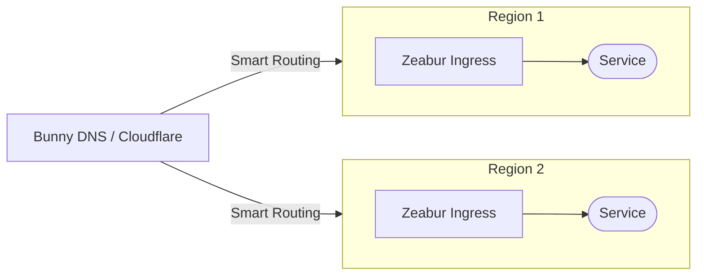
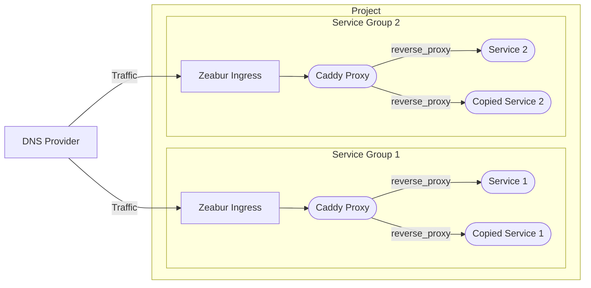
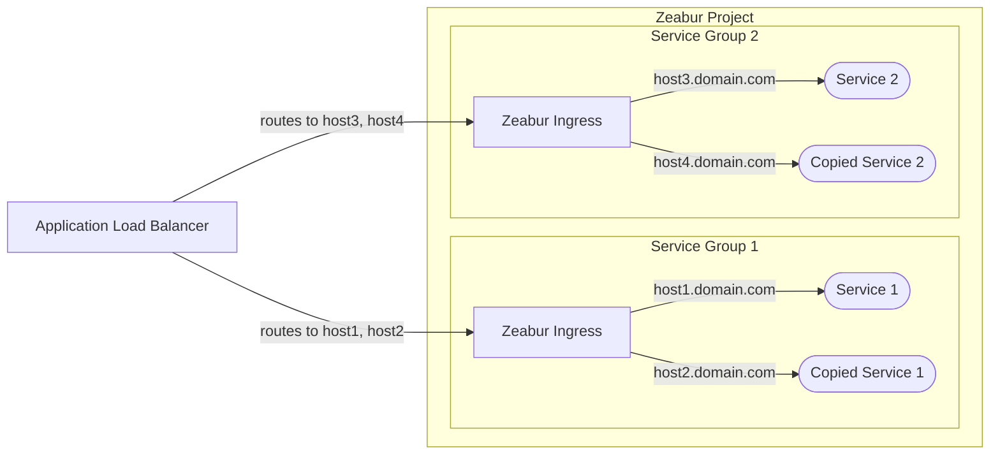

import { Callout } from 'nextra/components'

# Arsitektur Ketersediaan Tinggi

<Callout type="info">
  Arsitektur ketersediaan tinggi ini berlaku untuk **Server** maupun **Dedicated Cluster**. Namun, jika Anda menginginkan failover otomatis ke node yang sehat ketika satu node mati (yaitu dengan mengonfigurasi beberapa node Kubernetes), Anda memerlukan **Dedicated Cluster**. Zeabur juga sedang [menghentikan shared cluster secara bertahap](https://zeabur.com/changelogs/phasing-out-shared-cluster) — proyek baru sebaiknya menggunakan Server atau Dedicated Cluster.
</Callout>

Dokumen ini menguraikan arsitektur yang direkomendasikan untuk mencapai ketersediaan tinggi bagi layanan Anda yang di-deploy di Zeabur.

Perlu diperhatikan bahwa ini adalah topik lanjutan. Biasanya, layanan startup Anda tidak memerlukan ketersediaan tinggi (HA). Untuk solusi paling sederhana, tempatkan layanan Anda dalam satu proyek dan gunakan [jaringan privat](/deploy/networking/private-networking) untuk komunikasi. Ekspos layanan Anda ke Internet menggunakan [jaringan publik](/deploy/networking/public-networking). Kami dapat menangani vertical scaling untuk Anda. Di shared cluster, jika sebuah node mati, kami dapat secara otomatis memindahkan layanan Anda ke node lain.

## DNS Load Balancer (Direkomendasikan)

Pendekatan utama yang kami rekomendasikan adalah menggunakan [**DNS load balancer**](https://www.cloudflare.com/learning/performance/what-is-dns-load-balancing/). Metode ini umumnya lebih hemat biaya dan tidak mengganggu fungsi firewall serta rate limiting bawaan Zeabur.

Layanan seperti [Cloudflare](https://developers.cloudflare.com/load-balancing/understand-basics/proxy-modes/) dan [Bunny DNS](https://support.bunny.net/hc/en-us/articles/7247569381906-Understanding-Bunny-DNS-Load-Balancing) menawarkan fitur DNS load balancing yang andal. Untuk petunjuk penyiapan yang lengkap, silakan lihat dokumentasi resmi mereka.

Alur dasarnya adalah sebagai berikut:

## Mengonfigurasi Replika Layanan

Zeabur saat ini belum mendukung horizontal scaling otomatis. Untuk membuat instance redundan, Anda harus membuat salinan layanan Anda secara manual. Setelah memiliki replika layanan, Anda dapat menggunakan salah satu dari dua metode berikut untuk mendistribusikan traffic di antara replika tersebut.

### Opsi 1: Reverse Proxy Internal (Paling Direkomendasikan)

Opsi pertama adalah menggunakan reverse proxy internal, seperti [Caddy](https://zeabur.com/templates/FFDLWU) atau [NGINX](https://zeabur.com/templates/YIUNMF), untuk meneruskan request ke replika layanan Anda.

Dalam pengaturan ini, Anda mengonfigurasi reverse proxy untuk menyeimbangkan traffic di antara hostname internal salinan layanan Anda (misalnya `service-1-replica-1.zeabur.internal` dan `service-1-replica-2.zeabur.internal`).

Keuntungan utama metode ini adalah dapat bekerja dengan mulus bersama ingress controller Zeabur. Anda dapat memperoleh alamat IP asli klien menggunakan header standar `X-Forwarded-For` tanpa mengubah logika aplikasi Anda.

### Opsi 2: L7 Proxy Eksternal

Opsi kedua adalah menggunakan proxy Layer 7 eksternal, seperti [Application Load Balancer](https://developers.cloudflare.com/load-balancing/understand-basics/proxy-modes/) (ALB) dari penyedia cloud.

Meskipun metode ini tampak lebih sederhana karena Anda tidak perlu mengelola layanan Caddy internal, metode ini memiliki beberapa keterbatasan:

- **Header IP Asli**: Anda harus mengonfigurasi ALB untuk meneruskan IP asli klien dalam header kustom (misalnya `X-LoadBalancer-IP`) dan memodifikasi aplikasi Anda agar memercayai dan membaca header tersebut.
- **Risiko Keamanan**: Anda perlu mengonfigurasi firewall Zeabur agar hanya mengizinkan traffic dari alamat IP ALB. Jika tidak, pihak yang tidak bertanggung jawab dapat melewati ALB Anda dan mengirimkan header `X-LoadBalancer-IP` palsu langsung ke aplikasi Anda.
- **Rate Limiting**: Karena semua request berasal dari alamat IP ALB, rate limiting Zeabur dapat terpicu secara tidak terduga dan berpotensi memblokir traffic yang sah.

Kami berencana memberikan dukungan yang lebih baik untuk metode proxy eksternal guna mengatasi masalah ini di masa mendatang. Untuk saat ini, **reverse proxy internal (Opsi 1) adalah metode yang paling andal dan direkomendasikan** untuk digunakan di Zeabur.
