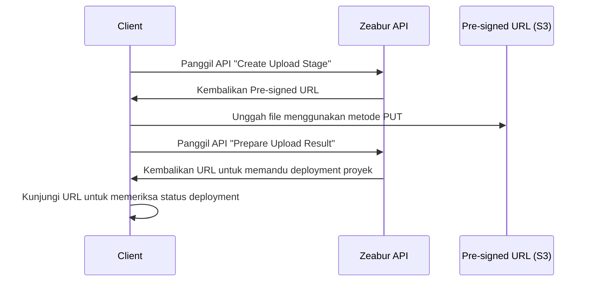

import { Callout } from 'nextra/components';

# API Publik

API Zeabur sebagian besar dibangun menggunakan GraphQL dan menjadi fondasi bagi serangkaian produk Zeabur seperti Zeabur Dashboard dan Zeabur CLI. Kami menyediakan API publik yang memungkinkan Anda mengendalikan Zeabur melalui kode.
Selain itu, Zeabur telah menempatkan sejumlah JSON schema dan spesifikasi OpenAPI untuk API non-GraphQL di [Schema Repository](https://schema.zeabur.app/).

## Autentikasi

Anda perlu menyertakan [API key](./api-keys) Anda di header `Authorization` untuk menggunakan Zeabur API dengan identitas Anda. Untuk petunjuk membuat API key, silakan baca [dokumen ini](./api-keys).

Berikut contoh cara menyertakannya:

```bash
curl --request POST \
  --url https://api.zeabur.com/graphql \
  --header 'Authorization: Bearer {YOUR_API_TOKEN}' \
  --header 'Content-Type: application/json' \
  --data '{"query":"query { me { username } }"}'
```

## GraphQL API

Anda dapat mengunjungi [Apollo Explorer](https://api.zeabur.com/apollo-explorer) kami untuk melihat semua metode GraphQL Zeabur API yang tersedia, mengujinya, dan menyalinnya sebagai perintah cURL.

Jika Anda lebih suka menulis GraphQL di IDE atau memerlukan petunjuk tipe, Anda dapat mengambil Schema Zeabur API lengkap dari [Apollo Explorer](https://api.zeabur.com/apollo-explorer) di bagian "Schema" → "SDL". Perhatikan bahwa Anda harus login ke Zeabur untuk mengakses schema tersebut.

Jika API yang Anda butuhkan tidak ada dalam Schema ini, beri tahu kami melalui [Zeabur Support](https://zeabur.com/support).

## Sumber daya milik tim

API key Anda terikat pada akun **pribadi** Anda — tim tidak memiliki API key sendiri. Key yang sama memberikan akses ke sumber daya di tim mana pun tempat Anda bergabung, dibatasi oleh izin peran Anda di tim tersebut.

Sebuah sumber daya (seperti proyek) dapat dimiliki oleh akun pribadi Anda atau oleh tim. Query dan mutation yang beroperasi pada sumber daya milik seseorang menerima argumen `ownerID`: berikan ID tim untuk bertindak atas tim tersebut, atau abaikan untuk bertindak atas akun pribadi Anda. Misalnya, untuk menampilkan daftar proyek sebuah tim:

```graphql
query TeamProjects($ownerID: ObjectID!) {
  projects(ownerID: $ownerID) {
    edges {
      node {
        _id    # ObjectID!
        name   # String!
      }
    }
  }
}
```

Untuk mengetahui tim tempat Anda bergabung beserta ID-nya, gunakan query `teams`:

```graphql
query MyTeams {
  teams {
    _id     # ObjectID!
    name    # String!
    myRole  # TeamMemberRole — peran Anda di tim ini
  }
}
```

<Callout type="info">
Menggunakan Zeabur CLI? CLI membungkus hal ini dalam konsep workspace — lihat [Workspace (Tim)](./cli#workspace-tim) di dokumentasi CLI.
</Callout>

## API Unggah Proyek Lokal

Meskipun deploy dari Git Repository merupakan metode utama, ada kalanya Anda perlu langsung melakukan deploy aplikasi yang sudah dikemas sebelumnya. Skenario umumnya meliputi:

- Proses CI/CD Anda menghasilkan artefak build, seperti file .zip.
- Anda ingin mengunggah proyek secara manual tetapi tidak ingin mengaitkannya dengan Git Repository.

Zeabur Upload API menyediakan API yang memungkinkan Anda mengunggah file ZIP secara langsung, yang kemudian akan diekstrak dan di-deploy secara otomatis oleh Zeabur ke proyek Anda.

### Konsep Inti: Unggah Aman Menggunakan Pre-signed URL

Zeabur Upload API memberikan Pre-signed URL kepada Anda, yaitu tautan sementara dan aman yang memberi Anda izin satu kali untuk mengunggah file secara langsung ke area staging kode Zeabur.

Seluruh alur kerja dapat digambarkan dengan diagram urutan berikut:



### Proses Unggah

Sebelum mulai mengunggah, Anda perlu memperoleh dua informasi tentang file:

- `content_length`: Ukuran file dalam byte.
- `content_hash`: Hash SHA256 dari konten file, dikodekan dalam Base64.

Kemudian Anda dapat membuat upload stage. Pertama, Anda perlu memberi tahu Zeabur bahwa Anda siap mengunggah file.

```http
POST /v2/upload
Content-Type: application/json

{
  "content_hash": "Your calculated BASE64 encoded SHA256 hash",
  "content_hash_algorithm": "sha256",
  "content_length": 12345678
}
```

Jika berhasil (201 Created), Zeabur akan mengembalikan detail Pre-signed URL dan `upload_id` untuk melacak upload stage ini.

```json
{
    "presign_header": { "Content-Type": "application/zip" },
    "presign_method": "PUT",
    "presign_url": "https://zeabur-uploads.s3.ap-east-1.amazonaws.com/...",
    "upload_id": "A unique UPLOAD_ID"
}
```

Selanjutnya, gunakan informasi yang diperoleh pada langkah sebelumnya untuk mengunggah file Anda. Perhatikan bahwa request ini dikirim ke `presign_url`, bukan ke Zeabur API.

- Metode: PUT (atau metode yang dikembalikan oleh presign_method pada langkah sebelumnya)
- URL: `presign_url` dari respons sebelumnya.
- Header: Anda harus menyertakan header yang dikembalikan di `presign_header` (misalnya Content-Type: application/zip).
- Body: Data biner mentah dari file zip Anda.

Saat request ini menerima respons 200 OK, berarti file Anda telah disimpan dengan aman. Terakhir, Anda perlu memberi tahu Zeabur bahwa file sudah siap dan bagaimana cara memprosesnya. Gunakan `upload_id` yang diperoleh sebelumnya untuk memanggil endpoint `POST /v2/upload/{upload_id}/prepare`.

```http
POST /v2/upload/{upload_id}/prepare
Content-Type: application/json
Authorization: Bearer {YOUR_API_TOKEN}
```

Tergantung pada tujuan Anda, ada dua opsi untuk Request Body. Jika Anda ingin mengunggah ke proyek yang sudah ada, Anda perlu menyertakan `service_id` dan `environment_id`. Tipe ini akan mengembalikan `url` yang mengarah ke deployment yang sedang berlangsung, yang dapat Anda gunakan untuk mengarahkan pengguna agar dapat melihat status deployment.

```json
{
  "upload_type": "existing_service",
  "service_id": "The ID of your existing service",
  "environment_id": "The ID of your service environment"
}
```

Jika Anda ingin memandu pengguna untuk membuat proyek, Anda cukup memberikan `new_project` sebagai `upload_type`. Tipe ini akan mengembalikan `url` yang dapat memandu pengguna untuk membuat proyek, dan Anda dapat mengarahkan mereka ke sana.

```json
{
  "upload_type": "new_project"
}
```

### Dokumentasi dan Schema

Untuk dokumentasi lengkap dan schema OpenAPI, lihat [Dokumentasi Upload API](https://schema.zeabur.app/upload-api/index.html).

## API Deployment Template

Jika Anda memiliki [file YAML spesifikasi template](https://schema.zeabur.app/template.json), Anda dapat menggunakan GraphQL mutation ini untuk melakukan deploy ke proyek tertentu:

```graphql
mutation DeployTemplate($rawSpecYaml: String, $projectId: ObjectID) {
  deployTemplate(rawSpecYaml: $rawSpecYaml, projectID: $projectId) {
    _id  # String!
  }
}
```

API ini cocok untuk deployment massal.

## API Operasi Container

API ini memungkinkan Anda mengunggah file ke atau mengunduh file dari layanan Zeabur tertentu, serta mengirim perintah ke layanan Zeabur tertentu.

### Unggah File

<Callout>
Saat ini, terdapat batas ukuran file 100MB untuk unggahan.
</Callout>

```http
POST https://api.zeabur.com/projects/project-id/services/service-id/files
Content-Type: multipart/form-data
Authorization: Bearer <YOUR_API_TOKEN>
```

- Payload (Form Content)
    - file (Blob): Konten file
    - path (string): Path file
    - environment (string): ID environment, yang dapat diperoleh dari `envID` di URL Dashboard
- Respons
    - 200 OK
    - 500 Internal Server Error, seperti `{"code": "INTERNAL_SERVER_ERROR", "error": "failed to upload file"}`


### Unduh File

```http
GET https://api.zeabur.com/projects/project-id/services/service-id/files?path=[PATH]&environment=[ENVIRONMENT]
Authorization: Bearer <YOUR_API_TOKEN>
```

- Query
    - path (string): Path file
    - environment (string): ID environment, yang dapat diperoleh dari `envID` di URL Dashboard
- Respons
    - 200 OK, `application/octet-stream`
    - 500 Internal Server Error, seperti `{"code": "INTERNAL_SERVER_ERROR", "error": "failed to download file"}`

### Daftar File

Gunakan API "Jalankan Perintah Tunggal" untuk menjalankan:

```shell
$ ls -A -a -F -1 /
```

### Hapus File

Gunakan API "Jalankan Perintah Tunggal" untuk menjalankan:

```shell
$ rm -r FILENAME
```

### Jalankan Perintah Tunggal

Gunakan GraphQL API untuk menjalankan:

```graphql
mutation ExecuteCommand($serviceId: ObjectID!, $environmentId: ObjectID!, $command: [String!]!) {
  executeCommand(serviceID: $serviceId, environmentID: $environmentId, command: $command) {
    exitCode  # Int!
    output    # String!
  }
}
```

### Gunakan WebSocket untuk Mengakses Terminal Layanan

- Endpoint WebSocket: `wss://api.zeabur.com/exec/<service-id>` 
- Konten yang ditulis ke WebSocket merupakan input yang sebenarnya
- Kontrol Resize: `[RESIZE_CONTROL, COLS_LSB, COLS_MSB, ROWS_LSB, ROWS_MSB]` 
  ```
  const buffer = new Uint8Array([
    RESIZE_CONTROL,
    dims.cols & 0xFF,
    dims.cols >> 8,
    dims.rows & 0xFF,
    dims.rows >> 8
  ]);
  ```

<Callout>
Untuk subscription GraphQL real-time (log, aktivitas proyek, dll.) melalui WebSocket, lihat [Panduan Koneksi WebSocket](./websocket-guide) yang lengkap.
</Callout>

### Mengambil Build Log

Gunakan GraphQL API untuk menjalankan:

```graphql
query BuildLogs($projectId: ObjectID!, $deploymentId: ObjectID!, $timestampCursor: Time) {
  buildLogs(projectID: $projectId, deploymentID: $deploymentId, timestampCursor: $timestampCursor) {
    message    # String!
    timestamp  # Time!
  }
}
```

### Mengambil Runtime Log

Gunakan GraphQL API untuk menjalankan:

```graphql
query RuntimeLogs($projectId: ObjectID!, $serviceId: ObjectID!, $environmentId: ObjectID!, $timestampCursor: Time) {
  runtimeLogs(projectID: $projectId, serviceID: $serviceId, environmentID: $environmentId, timestampCursor: $timestampCursor) {
    message    # String!
    timestamp  # Time!
  }
}
```

### Subscribe ke Build Log

Gunakan GraphQL API untuk menjalankan:

```graphql
subscription BuildLogReceived($projectId: ObjectID!, $deploymentId: ObjectID!) {
  buildLogReceived(projectID: $projectId, deploymentID: $deploymentId) {
    message    # String!
    timestamp  # Time!
  }
}
```

### Subscribe ke Runtime Log

Gunakan GraphQL API untuk menjalankan:

```graphql
subscription RuntimeLogReceived($projectId: ObjectID!, $serviceId: ObjectID!, $environmentId: ObjectID!) {
  runtimeLogReceived(projectID: $projectId, serviceID: $serviceId, environmentID: $environmentId) {
    message    # String!
    timestamp  # Time!
  }
}
```
