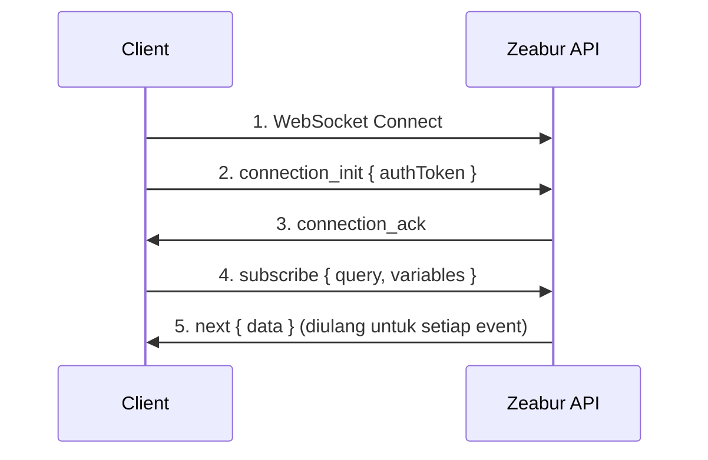

import { Callout } from 'nextra/components';

# Panduan Koneksi WebSocket

Panduan ini menjelaskan cara membuat koneksi WebSocket terautentikasi ke Zeabur GraphQL API untuk subscription real-time (log, aktivitas proyek, dll.).

## Ikhtisar

Zeabur menggunakan protokol [graphql-ws](https://github.com/enisdenjo/graphql-ws) untuk subscription GraphQL melalui WebSocket. Koneksi memerlukan autentikasi melalui token yang dikirimkan dalam payload `connection_init`.

## Endpoint Koneksi

| Lingkungan | URL WebSocket |
|-------------|---------------|
| Global | `wss://api.zeabur.com/graphql` |
| Tiongkok | `wss://api.zeabur.cn/graphql` |

## Autentikasi

Koneksi WebSocket diautentikasi dengan mengirimkan `authToken` di dalam `connectionParams` selama fase inisialisasi koneksi.

### Sumber Token

Token autentikasi dapat diperoleh dengan dua cara:

1. **Dari Cookie** - Saat menggunakan Zeabur Dashboard, token disimpan dalam cookie bernama `token`:

```javascript
// Ambil token dari cookie
const token = document.cookie
  .split('; ')
  .find(row => row.startsWith('token='))
  ?.split('=')[1];
```

2. **Menggunakan API Key** - Untuk akses terprogram, Anda dapat menggunakan [API key](./api-keys) Anda sebagai token autentikasi.

## Alur Koneksi



## Implementasi

### Menggunakan Apollo Client (Direkomendasikan)

Ini adalah pendekatan yang direkomendasikan untuk aplikasi React:

```typescript
import { GraphQLWsLink } from '@apollo/client/link/subscriptions';
import { createClient } from 'graphql-ws';

const wsLink = new GraphQLWsLink(createClient({ 
  url: 'wss://api.zeabur.com/graphql',
  connectionParams: () => {
    // Ambil token autentikasi dari cookie
    const token = document.cookie
      .split('; ')
      .find(row => row.startsWith('token='))
      ?.split('=')[1];
    
    return {
      authToken: token,
    };
  },
}));
```

### Menggunakan Client graphql-ws Secara Langsung

Untuk implementasi tanpa Apollo:

```typescript
import { createClient } from 'graphql-ws';

const client = createClient({
  url: 'wss://api.zeabur.com/graphql',
  connectionParams: {
    authToken: 'YOUR_API_TOKEN',
  },
});

// Subscribe ke runtime log
const unsubscribe = client.subscribe(
  {
    query: `
      subscription SubscribeRuntimeLog(
        $projectID: ObjectID!
        $serviceID: ObjectID!
        $environmentID: ObjectID!
      ) {
        runtimeLogReceived(
          projectID: $projectID
          serviceID: $serviceID
          environmentID: $environmentID
        ) {
          timestamp
          message
        }
      }
    `,
    variables: {
      projectID: 'your-project-id',
      serviceID: 'your-service-id',
      environmentID: 'your-environment-id',
    },
  },
  {
    next: (data) => console.log('Received:', data),
    error: (err) => console.error('Error:', err),
    complete: () => console.log('Completed'),
  }
);
```

### Menggunakan API WebSocket Native

Untuk pengujian atau implementasi tingkat rendah:

```javascript
const API_URL = 'wss://api.zeabur.com/graphql';

// 1. Buat koneksi WebSocket dengan subprotokol graphql-ws
const ws = new WebSocket(API_URL, 'graphql-transport-ws');

ws.onopen = () => {
  // 2. Kirim connection_init dengan token autentikasi
  ws.send(JSON.stringify({
    type: 'connection_init',
    payload: {
      authToken: 'YOUR_AUTH_TOKEN'
    }
  }));
};

ws.onmessage = (event) => {
  const message = JSON.parse(event.data);
  
  switch (message.type) {
    case 'connection_ack':
      // 3. Koneksi terautentikasi, sekarang lakukan subscribe
      ws.send(JSON.stringify({
        id: '1',
        type: 'subscribe',
        payload: {
          query: `
            subscription SubscribeRuntimeLog(
              $projectID: ObjectID!
              $serviceID: ObjectID!
              $environmentID: ObjectID!
            ) {
              runtimeLogReceived(
                projectID: $projectID
                serviceID: $serviceID
                environmentID: $environmentID
              ) {
                timestamp
                message
              }
            }
          `,
          variables: {
            projectID: 'your-project-id',
            serviceID: 'your-service-id',
            environmentID: 'your-environment-id'
          }
        }
      }));
      break;
      
    case 'next':
      // 4. Data subscription diterima
      console.log('Data:', message.payload.data);
      break;
      
    case 'error':
      console.error('Subscription error:', message.payload);
      break;
      
    case 'complete':
      console.log('Subscription completed');
      break;
  }
};

ws.onerror = (error) => console.error('WebSocket error:', error);
ws.onclose = (event) => console.log('WebSocket closed:', event.code);
```

## Tipe Pesan (protokol graphql-ws)

### Client → Server

| Tipe | Deskripsi |
|------|-------------|
| `connection_init` | Inisialisasi koneksi dengan payload autentikasi |
| `subscribe` | Memulai subscription |
| `complete` | Menghentikan subscription |
| `ping` | Ping keep-alive |

### Server → Client

| Tipe | Deskripsi |
|------|-------------|
| `connection_ack` | Koneksi diterima |
| `next` | Data subscription |
| `error` | Error subscription |
| `complete` | Subscription berakhir |
| `pong` | Respons keep-alive |

## Subscription yang Tersedia

### Runtime Log

Subscribe ke runtime log real-time dari sebuah layanan:

```graphql
subscription SubscribeRuntimeLog(
  $projectID: ObjectID!
  $serviceID: ObjectID!
  $environmentID: ObjectID!
) {
  runtimeLogReceived(
    projectID: $projectID
    serviceID: $serviceID
    environmentID: $environmentID
  ) {
    timestamp
    message
  }
}
```

### Runtime Log (dengan filter Deployment)

Filter log ke deployment tertentu:

```graphql
subscription SubscribeRuntimeLogWithDeployment(
  $projectID: ObjectID!
  $serviceID: ObjectID!
  $environmentID: ObjectID!
  $deploymentID: ObjectID
) {
  runtimeLogReceived(
    projectID: $projectID
    serviceID: $serviceID
    environmentID: $environmentID
    deploymentID: $deploymentID
  ) {
    timestamp
    message
  }
}
```

### Build Log

Subscribe ke build log untuk sebuah deployment:

```graphql
subscription SubscribeBuildLog(
  $projectID: ObjectID!
  $deploymentID: ObjectID!
) {
  buildLogReceived(
    projectID: $projectID
    deploymentID: $deploymentID
  ) {
    timestamp
    message
  }
}
```

### Aktivitas Proyek

Subscribe ke event di seluruh proyek (build, deployment, perubahan status layanan):

```graphql
subscription SubscribeProjectActivity($projectID: ObjectID!) {
  projectActivityReceived(projectID: $projectID) {
    type
    payload
  }
}
```

## Penanganan Error

### Error Autentikasi

Jika token tidak ada atau tidak valid, server akan menolak koneksi selama fase `connection_init`:

```json
{
  "type": "error",
  "payload": {
    "message": "Please establish websocket connection with a valid token"
  }
}
```

### Error Izin

Jika sudah terautentikasi tetapi tidak memiliki akses ke suatu sumber daya:

```json
{
  "type": "next",
  "id": "1",
  "payload": {
    "errors": [{
      "message": "Permission denied",
      "path": ["runtimeLogReceived"],
      "extensions": {
        "code": "FORBIDDEN"
      }
    }],
    "data": null
  }
}
```

**Penyebab umum:**

- ID project/service/environment salah
- Pengguna tidak memiliki akses ke proyek
- ID tidak cocok (misalnya layanan bukan bagian dari proyek tersebut)

## Menguji Koneksi

### Browser DevTools

1. Buka tab Network
2. Filter berdasarkan "WS"
3. Buka halaman yang menggunakan subscription (misalnya log deployment)
4. Klik koneksi WebSocket untuk memeriksa frame

### Halaman Uji Mandiri

Simpan file HTML ini dan buka di browser tempat Anda sudah login ke Zeabur:

```html
<!DOCTYPE html>
<html>
<head>
  <title>Zeabur WebSocket Test</title>
  <style>
    body { font-family: system-ui; padding: 20px; }
    input { margin: 5px; padding: 8px; }
    button { padding: 8px 16px; cursor: pointer; }
    pre { background: #f5f5f5; padding: 15px; overflow: auto; max-height: 400px; }
  </style>
</head>
<body>
  <h1>Zeabur WebSocket Connection Test</h1>
  <div>
    <input id="projectId" placeholder="Project ID" />
    <input id="serviceId" placeholder="Service ID" />
    <input id="envId" placeholder="Environment ID" />
    <button onclick="connect()">Connect</button>
  </div>
  <pre id="logs"></pre>
  
  <script>
    function log(msg) {
      const el = document.getElementById('logs');
      el.textContent += new Date().toISOString() + ' | ' + msg + '\n';
      el.scrollTop = el.scrollHeight;
    }
    
    function connect() {
      const token = document.cookie.split('; ')
        .find(r => r.startsWith('token='))?.split('=')[1];
      
      if (!token) {
        log('ERROR: No token found in cookies. Make sure you are logged into Zeabur.');
        return;
      }
      
      log('Token found, connecting...');
      const ws = new WebSocket('wss://api.zeabur.com/graphql', 'graphql-transport-ws');
      
      ws.onopen = () => {
        log('Connected, sending authentication...');
        ws.send(JSON.stringify({
          type: 'connection_init',
          payload: { authToken: token }
        }));
      };
      
      ws.onmessage = (e) => {
        const msg = JSON.parse(e.data);
        log('Received: ' + JSON.stringify(msg, null, 2));
        
        if (msg.type === 'connection_ack') {
          log('Authenticated successfully! Starting subscription...');
          ws.send(JSON.stringify({
            id: '1',
            type: 'subscribe',
            payload: {
              query: `subscription($p:ObjectID!,$s:ObjectID!,$e:ObjectID!){
                runtimeLogReceived(projectID:$p,serviceID:$s,environmentID:$e){
                  timestamp message
                }
              }`,
              variables: {
                p: document.getElementById('projectId').value,
                s: document.getElementById('serviceId').value,
                e: document.getElementById('envId').value
              }
            }
          }));
        }
      };
      
      ws.onerror = (e) => log('WebSocket Error: ' + JSON.stringify(e));
      ws.onclose = (e) => log('Connection Closed: code=' + e.code + ', reason=' + e.reason);
    }
  </script>
</body>
</html>
```

## Pertimbangan Keamanan

<Callout type="warning">
Token autentikasi yang diakses melalui `document.cookie` disimpan dalam cookie non-HttpOnly. Ini adalah kompromi yang diperlukan karena WebSocket tidak dapat mengirim cookie HttpOnly secara otomatis.
</Callout>

### Mitigasi

1. **Content Security Policy (CSP)** - Mencegah serangan XSS yang dapat mencuri token
2. **Masa berlaku token yang singkat** - Membatasi kerugian jika token bocor
3. **Atribut cookie SameSite** - Mencegah serangan CSRF
4. **Gunakan API Key untuk sisi server** - Untuk aplikasi backend, gunakan [API key](./api-keys) alih-alih token sesi

## Pemecahan Masalah

| Masalah | Solusi |
|-------|----------|
| Tidak menerima `connection_ack` | Pastikan token valid dan belum kedaluwarsa |
| `Permission denied` pada subscription | Pastikan ID sudah benar dan pengguna memiliki akses |
| Koneksi langsung tertutup | Periksa URL WebSocket dan pastikan subprotokolnya `graphql-transport-ws` |
| Tidak ada data yang diterima | Pastikan layanan sedang berjalan dan menghasilkan log |
| `WebSocket connection failed` | Periksa konektivitas jaringan dan pengaturan firewall |

## Sumber Daya Terkait

- [API Publik](./public-api) - Ikhtisar semua API Zeabur
- [Membuat dan Menggunakan API Key](./api-keys) - Cara membuat token API
- [graphql-ws Protocol](https://github.com/enisdenjo/graphql-ws/blob/master/PROTOCOL.md) - Spesifikasi resmi protokol
- [Apollo Explorer](https://api.zeabur.com/apollo-explorer) - Jelajahi operasi GraphQL yang tersedia

