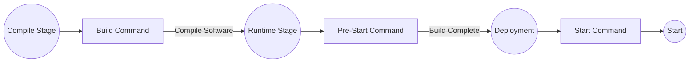

# Deploy Aplikasi Rust

Pada prinsipnya, Zeabur mendukung semua jenis aplikasi Rust—secara default, Zeabur akan otomatis mencari file executable. Jika proyek Anda memiliki beberapa executable, Anda dapat menentukan nama file executable di kolom "Nama Layanan" (atau menggunakan `ZBPACK_RUST_ENTRY`).

Jika Anda belum memiliki proyek, Anda dapat melakukan fork repositori [zeabur/axum-template](https://github.com/zeabur/axum-template) ke akun GitHub Anda dan mencoba men-deploy-nya di Zeabur.

## Jenis Proyek yang Didukung

- Proyek Executable Tunggal: Proyek Rust yang hanya memiliki `src/main.rs` sebagai entry point. Zeabur akan otomatis menemukan executable pertama yang dihasilkan setelah `cargo install`.
- Proyek dengan Beberapa Executable: Jika proyek Anda memiliki executable lain di `src/bin` selain `src/main.rs`, tentukan nama artefak akhir yang ingin Anda jalankan di kolom "Nama Layanan" atau konfigurasikan di `zbpack.json`:
  ```json
  {
    "rust": {
      "entry": "your-entry"
    }
  }
  ```
  Anda juga dapat menggunakan environment variable `ZBPACK_RUST_ENTRY` untuk mendapatkan hasil yang sama.
- Monorepo Cargo Workspace: Jika proyek Anda terdiri dari beberapa crate, tentukan nama artefak akhir yang ingin Anda jalankan di kolom "Nama Layanan". Secara default, `cargo install` akan menginstal **semua proyek** di dalam workspace. Selain menggunakan metode `ZBPACK_RUST_ENTRY` di atas untuk menentukan nama executable, Anda juga dapat langsung menentukan lokasi workspace aplikasi ini di `zbpack.json`. Jika aplikasi Anda berada di folder `rest-api` pada direktori root repositori, Anda dapat mengonfigurasinya sebagai berikut:
  ```json
  {
    "rust": {
      "app_dir": "rest-api"
    }
  }
  ```
  Anda juga dapat menggunakan environment variable `ZBPACK_RUST_APP_DIR` untuk mendapatkan hasil yang sama.

Jika executable yang ditentukan tidak ada, Zeabur akan kembali ke mode deteksi otomatis. "Deteksi otomatis" akan mencari semua executable hasil kompilasi dan menjalankan file pertama yang ditemukan. Karena mode ini mudah salah menebak pada skenario multi-proyek, sebaiknya tentukan "Nama Layanan" yang benar untuk skenario proyek yang lebih kompleks. Lihat bagian berikut untuk mengetahui cara menemukan dan menentukannya.

## Menemukan Nama Artefak Akhir

Artefak akhir dapat ditemukan di `target/release` dalam proyek Anda. Untuk menemukan nama filenya:

1. Anda memerlukan Rust toolchain untuk mengompilasi proyek. Unduh dari [situs web resmi Rust](https://www.rust-lang.org).
2. Clone proyek yang ingin Anda deploy dan masuk ke direktori proyek.
3. Jalankan `cargo build --release` untuk mengompilasi proyek.

    ```bash
    $ cargo run --release
    Compiling zeabur v0.1.0 (/project)
      Finished release [optimized] target(s) in 0.65s
      Running `target/release/zeabur`
    ```

4. Temukan baris Running `target/release/zeabur`, lalu ambil nama executable akhirnya (zeabur).
5. Isikan `zeabur` di Nama Layanan atau `ZBPACK_RUST_ENTRY`.

Artefak akhir (entry point) akan diberi nama `/app/main`.

## Menyalin File Lain

Jika proyek Anda bergantung pada file lain di codebase selain executable. Misalnya:

```plain
*
|`-- public  <-- Program Anda bergantung pada folder ini
|`-- src
|  `-- main.rs
|`-- Cargo.toml
|`-- Cargo.lock
`--- config.toml   <-- Program Anda bergantung pada file ini
```

Anda dapat menentukan `rust.assets` di `zbpack.json`, dengan mencantumkan folder atau file yang ingin Anda pertahankan. Nama folder harus diakhiri dengan `/`. Contoh:

```json
{
  "rust": {
    "assets": [
      "public/",
      "config.toml"
    ]
  }
}
```

## Perintah Build dan Start Kustom

Zeabur menyediakan "perintah build", "perintah start", dan "perintah pre-start" untuk Rust, sehingga Anda dapat menyisipkan dependensi yang diperlukan atau menulis file yang dibutuhkan pada berbagai tahap proses build proyek Rust Anda.



### Perintah Build

Anda dapat menggunakan `ZBPACK_BUILD_COMMAND` untuk menentukan **perintah yang dijalankan sebelum kompilasi**, misalnya:

```
ZBPACK_BUILD_COMMAND=apt update && apt install -y sqlite3 && rm -rf /var/lib/apt/lists/*
```

Anda juga dapat menentukannya di `zbpack.json`:

```json
{
  "build_command": "apt update && apt install -y sqlite3 && rm -rf /var/lib/apt/lists/*"
}
```

### Perintah Start

Anda dapat menggunakan `ZBPACK_START_COMMAND` untuk menimpa perintah start default yang ditentukan oleh Zeabur, misalnya:

```
ZBPACK_START_COMMAND="/app/main --debug"
```

Anda juga dapat menentukannya di `zbpack.json`:

```json
{
  "start_command": "/app/main --debug"
}
```

### Perintah Pre-Start

Jika Anda perlu menginstal beberapa dependensi sebelum aplikasi dijalankan, Anda dapat menggunakan `ZBPACK_PRE_START_COMMAND` untuk menentukan perintah yang dijalankan sebelum eksekusi:

```
ZBPACK_PRE_START_COMMAND="apt update && apt install -y sqlite3 && rm -rf /var/lib/apt/lists/*"
```

Anda juga dapat menentukannya di `zbpack.json`:

```json
{
  "pre_start_command": "apt update && apt install -y sqlite3 && rm -rf /var/lib/apt/lists/*"
}
```

Dibandingkan dengan `ZBPACK_START_COMMAND`, hasilnya akan tetap tersimpan dan tidak dijalankan ulang setiap kali sistem di-restart, sehingga proses startup menjadi lebih cepat.

### Instalasi Dependensi Otomatis

Jika proyek Anda bergantung pada OpenSSL dan mencantumkannya secara eksplisit di `Cargo.toml` (atau bergantung padanya secara tidak langsung melalui `Cargo.lock`), Zeabur akan otomatis menginstal library runtime `openssl`.

## Environment Runtime

Saat ini Zeabur menggunakan [`rust:1-silm`](https://hub.docker.com/_/rust) sebagai image runtime. Executable Anda akan ditempatkan di direktori `/app`, dengan `/` (direktori root) sebagai direktori kerja.

File di `rust.assets` akan ditempatkan di direktori `/app`, yaitu direktori yang sama dengan file executable. Jika Anda perlu membaca aset, dalam praktiknya Anda biasanya membaca file dari **path yang relatif terhadap executable**. Contoh berikut akan mendapatkan lokasi aset `images` Anda.

```rust
use std::env;
use std::path::Path;

fn main() {
    let exe_path = env::current_exe().expect("Failed to get current executable path");
    let exe_dir = exe_path.parent().expect("Failed to get executable directory");
    let relative_path = exe_dir.join("images");

    println!("config.toml path: {:?}", relative_path);
}
```

Perlu diperhatikan bahwa file konfigurasi **biasanya dibaca dari direktori kerja**. Karena direktori kerjanya adalah direktori root, Anda sebaiknya menempatkan konfigurasi di `/config.toml` (bukan `/app/config.toml`) saat menambahkan file konfigurasi menggunakan Editor Konfigurasi. Setelah itu, baca file tersebut dari direktori kerja:

```rust
use std::env;
use std::fs::File;
use std::io::{self, Read};
use std::path::PathBuf;

fn main() -> io::Result<()> {
    let current_dir = env::current_dir()?;
    let config_path: PathBuf = current_dir.join("config.toml");

    // Disarankan menggunakan serde untuk deserialisasi. Ini hanya demo, jadi di sini digunakan read_to_string.
    let mut file = File::open(config_path)?;
    let mut contents = String::new();
    file.read_to_string(&mut contents)?;

    println!("Config file contents:\n{}", contents);

    Ok(())
}
```
