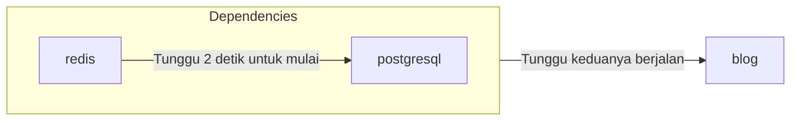

# Membuat Template dari YAML

Anda dapat menggunakan CLI `zeabur` untuk melakukan deploy, membuat, dan mengelola template dari YAML dengan format yang mirip dengan [Docker Compose](https://docs.docker.com/compose/) atau [Kubernetes Object](https://kubernetes.io/docs/concepts/overview/working-with-objects/).

## Format YAML (Resource)

Zeabur menggunakan satu file YAML untuk mendeskripsikan resource template, yang disebut **Template Resource**.

```yaml
apiVersion: zeabur.com/v1
kind: Template
metadata:
    name: RSSHub
spec:
    description: Everything is RSSible
    icon: https://docs.rsshub.app/logo.png
    coverImage: https://zeabur.com/docs/_next/image?url=%2Fdocs%2F_next%2Fstatic%2Fmedia%2Fintro.5b73c4f8.png&w=3840&q=75
    variables:
        - key: PUBLIC_DOMAIN
          type: DOMAIN
          name: Domain
          description: What is the domain you want for your RSSHub?
    tags:
        - Tool
    readme: |-
        # RSSHub
        RSSHub is an open source, easy to use, and extensible RSS feed aggregator, it's capable of generating RSS feeds from pretty much everything.

        RSSHub delivers millions of contents aggregated from all kinds of sources, our vibrant open source community is ensuring the deliver of RSSHub's new routes, new features and bug fixes.
    services:
        - name: Redis
          icon: https://raw.githubusercontent.com/zeabur/service-icons/main/marketplace/redis.svg
          template: PREBUILT
          spec:
            source:
                image: redis/redis-stack-server:latest
            ports:
                - id: database
                  port: 6379
                  type: TCP
            volumes:
                - id: data
                  dir: /data
            instructions:
                - type: TEXT
                  title: Command to connect to your Redis
                  content: redis-cli -h ${PORT_FORWARDED_HOSTNAME} -p ${DATABASE_PORT_FORWARDED_PORT} -a ${REDIS_PASSWORD}
                - type: TEXT
                  title: Redis Connection String
                  content: redis://:${REDIS_PASSWORD}@${PORT_FORWARDED_HOSTNAME}:${DATABASE_PORT_FORWARDED_PORT}
                - type: PASSWORD
                  title: Redis password
                  content: ${REDIS_PASSWORD}
                  category: Credentials
                - type: TEXT
                  title: Redis host
                  content: ${PORT_FORWARDED_HOSTNAME}
                  category: Hostname & Port
                - type: TEXT
                  title: Redis port
                  content: ${DATABASE_PORT_FORWARDED_PORT}
                  category: Hostname & Port
            env:
                REDIS_ARGS:
                    default: --requirepass ${REDIS_PASSWORD}
                REDIS_CONNECTION_STRING:
                    default: redis://:${REDIS_PASSWORD}@${REDIS_HOST}:${REDIS_PORT}
                    expose: true
                    readonly: true
                REDIS_HOST:
                    default: ${CONTAINER_HOSTNAME}
                    expose: true
                    readonly: true
                REDIS_PASSWORD:
                    default: ${PASSWORD}
                    expose: true
                REDIS_PORT:
                    default: ${DATABASE_PORT}
                    expose: true
                    readonly: true
                REDIS_URI:
                    default: ${REDIS_CONNECTION_STRING}
                    expose: true
                    readonly: true
        - name: RSSHub
          icon: https://docs.rsshub.app/logo.png
          template: PREBUILT
          domainKey: PUBLIC_DOMAIN
          spec:
            source:
                image: diygod/rsshub
            ports:
                - id: web
                  port: 1200
                  type: HTTP
            env:
                CACHE_TYPE:
                    default: ${REDIS_URI}
                REDIS_URL:
                    default: ${REDIS_URI}

localization:
  zh-TW:
    description: LobeChat 是一個開源的高效能聊天機器人框架。
    variables:
      - key: PUBLIC_DOMAIN
        type: DOMAIN
        name: 網域
        description: 你想將 RSSHub 綁在哪個網域上？
    readme: |-
        # RSSHub
        RSSHub 是一個開源、易於使用且可擴展的 RSS 資訊聚合器，能夠從幾乎所有來源生成 RSS 資訊。

        RSSHub 提供來自各種來源的數百萬內容，我們充滿活力的開源社群確保提供 RSSHub 的新路線、新功能和錯誤修復。
```

Sebuah **Template** dapat dibagi menjadi tiga bagian utama: "Informasi Template", "Spesifikasi Layanan", dan "Lokalisasi". Format lengkapnya dapat dilihat di [Zeabur Schema Repository](https://json-schema.app/view/%23?url=https%3A%2F%2Fschema.zeabur.app%2Ftemplate.json). Berikut penjelasan singkat mengenai fungsi setiap field dan cara field tersebut ditampilkan di halaman template Zeabur.

### Definisi Template


`apiVersion` dan `kind` selalu bernilai `zeabur.com/v1` dan `Template`.

Di dalam `metadata`, `name` adalah nama template bebas, seperti `RSSHub`, `Lobe-Chat`, dan `ChatGPT API`. Nama ini akan muncul di blok `WeWe RSS` pada gambar di atas.

Di dalam `spec`, `description` adalah ringkasan singkat template yang ditampilkan di bawah judul template. `icon` adalah ikon template, berupa URL yang mengarah ke sebuah gambar, dan ditampilkan di samping judul template. `tags` adalah label template; kategori referensinya dapat dilihat di [bagian `Tags` di sisi kiri halaman penelusuran template](https://zeabur.com/templates). Tag yang tepat tidak hanya membantu pengguna menemukan template dengan mudah, tetapi juga mengoptimalkan SEO.

`readme` adalah dokumentasi template yang ditulis dalam format Markdown dan ditampilkan di bagian bawah halaman template. `coverImage` ditampilkan di atas dokumentasi dan juga berupa URL yang mengarah ke sebuah gambar; field ini boleh dikosongkan.

`variables` adalah variabel yang dapat diatur pengguna saat deploy. `type` dapat berupa `STRING` (string variabel biasa) atau `DOMAIN` (Zeabur akan memandu pengaturan domain); `key` sesuai dengan environment variable layanan, dan Zeabur akan secara otomatis membuat environment variable tersebut di semua layanan sesuai yang ditentukan. `name` dan `description` sesuai dengan nama dan deskripsi variabel saat deploy template, seperti yang ditunjukkan di bawah ini.


### Spesifikasi Layanan


`services` adalah spesifikasi layanan template. Zeabur akan melakukan deploy layanan yang ditentukan ke dalam proyek saat deploy. `name` adalah nama layanan, dan `icon` adalah ikonnya. `template` menyatakan apakah layanan tersebut berupa Docker image (`PREBUILT`) atau layanan yang di-deploy dari Git (`GIT`).

`dependencies` menyatakan layanan-layanan yang menjadi dependensi layanan ini. Zeabur dapat menunggu layanan yang ditentukan berjalan terlebih dahulu sebelum menjalankan layanan Anda, sehingga Anda terhindar dari keharusan me-restart layanan berulang kali. Misalnya, jika layanan `blog` Anda bergantung pada `redis` dan `postgresql`, Anda dapat menuliskannya seperti di bawah ini. Perhatikan bahwa `redis` dan `postgresql` juga harus merupakan layanan yang didefinisikan di dalam template.

```yaml
dependencies:
    - redis
    - postgresql
```

Hubungan urutan startup-nya adalah sebagai berikut:



`domainKey` menunjukkan ke layanan mana variabel domain (bertipe `DOMAIN`) dalam definisi template harus dihubungkan. Pada contoh di atas, `spec.variables` memiliki variabel `PUBLIC_DOMAIN` bertipe `DOMAIN`, dan spesifikasi layanan RSSHub memiliki `domainKey` yang mengarah ke `PUBLIC_DOMAIN`. Saat deploy, domain yang diatur di `PUBLIC_DOMAIN` akan dihubungkan ke layanan RSSHub.

`spec` adalah Spesifikasi Layanan. Informasi detail tentang setiap field dapat ditemukan di [dokumentasi Spesifikasi Layanan Template](https://json-schema.app/view/%23/%23%2Fproperties%2Fspec/%23%2Fproperties%2Fspec%2Fproperties%2Fservices%2Fitems/%23%2Fproperties%2Fspec%2Fproperties%2Fservices%2Fitems%2Fproperties%2Fspec?url=https%3A%2F%2Fschema.zeabur.app%2Ftemplate.json). Berikut penjelasan singkat mengenai poin-poin penting dalam spesifikasi layanan:

Untuk layanan `PREBUILT`, Anda perlu menentukan Docker image (`image`), dan secara opsional perintah eksekusi beserta parameternya (`command` dan `args`). Jika image Anda disimpan di registry privat, Anda dapat menentukan `username` dan `password` untuk melakukan pull. Selain itu, Anda dapat menentukan ID pengguna (`runAsUserID`) untuk menjalankan container dalam mode non-root. Untuk layanan `GIT`, Anda perlu menentukan jenis repositori Git (saat ini hanya `GITHUB`), ID repositori (saat ini hanya [`repoID`](https://stackoverflow.com/a/47223479) GitHub), dan secara opsional branch (`branch`).

`ports` menentukan Port layanan yang akan diekspos ke proyek atau bahkan ke luar. Layanan HTTP dapat diakses menggunakan nama domain (misalnya `https://my-service.zeabur.app`), sedangkan layanan TCP dan UDP dapat menggunakan tautan forwarding Zeabur `xxx.clusters.zeabur.com:12345`. Misalnya, jika `type` adalah `HTTP` dan `port` adalah `12345`, orang lain dapat terhubung ke layanan Anda yang mendengarkan port `12345` melalui `https://my-service.zeabur.app`.

`volumes` menentukan path penyimpanan persisten untuk layanan. Pada prinsipnya, Zeabur akan mengembalikan layanan ke kondisi awal (Stateless) setiap kali dilakukan Redeploy atau Restart. Namun, jika Anda perlu menyimpan sebagian data secara persisten, Anda dapat menggunakan `volumes` untuk menentukan path penyimpanan persisten. Misalnya, jika `dir` adalah `/data`, artinya layanan Anda dapat menyimpan data secara persisten di bawah path `/data` hingga layanan tersebut dihapus.

`instructions` memberi tahu pengguna lain cara menggunakan layanan Anda, seperti contoh `Redis Connection String` yang menjelaskan cara orang lain terhubung ke Redis menggunakan Client. `type` dapat berupa `DOMAIN` (tombol yang mengarahkan ke URL tertentu saat diklik), `TEXT` (teks), atau `PASSWORD` (kata sandi, disembunyikan secara default), sedangkan `category` adalah klasifikasi yang dapat disesuaikan dan saat ini belum ditampilkan di frontend.

`env` adalah environment variables layanan. `default` adalah nilai default environment variable, `expose` menunjukkan apakah proyek lain dapat langsung menggunakan variabel ini atau mereferensikannya menggunakan sintaks `${VARIABLE}`, dan `readonly` menunjukkan apakah variabel tersebut bersifat read-only (tidak dapat diubah setelah layanan dibuat). Misalnya, jika `expose` dari `REDIS_CONNECTION_STRING` bernilai `true`, layanan lain dapat terhubung ke Redis melalui environment variable `REDIS_CONNECTION_STRING`, dan juga dapat mereferensikan connection string ini di environment variable lain menggunakan `${REDIS_CONNECTION_STRING}`.

`configs` adalah pengaturan berbasis file untuk layanan. Anda dapat menggunakan `path` dan `template` untuk menentukan file konfigurasi default sehingga pengguna dapat mengubahnya dengan lebih mudah. Gunakan `envsubst` untuk mengganti referensi variabel di dalam template dengan nilai yang sesuai. Misalnya, ketika `envsubst` diaktifkan dan variabel `MONGO_URI=mongodb://mongo.zeabur.internal:27017` telah diatur:

```yaml {6}
configs:
    - path: /config.yaml
      template: |
        mongo:
            uri: ${MONGO_URI}
      envsubst: true
```

File `/config.yml` akan berisi konten berikut di dalam instance layanan:

```yaml filename="/config.yaml"
mongo:
    uri: mongodb://mongo.zeabur.internal:27017
```

Anda juga dapat menentukan `permission` untuk file konfigurasi Anda. Perhatikan bahwa `permission` harus berupa bilangan desimal yang dikonversi dari [izin file UNIX](https://mason.gmu.edu/~montecin/UNIXpermiss.htm) dalam bentuk oktal. Berikut beberapa pemetaan izin yang umum:

| Nilai `permission` | Nilai oktal asli | Baca | Tulis | Eksekusi | Cocok untuk |
| ------------------ | --------------- | ---- | ----- | ------- | ------------ |
| 256                | 0400            | O    | X     | X       | File rahasia (misalnya kata sandi) |
| 420                | 0644            | O    | O     | X       | File biasa yang dapat dibaca dan ditulis. Izin default |
| 493                | 0755            | O    | O     | O       | File yang dapat dieksekusi (misalnya skrip bash) |

"Baca", "Tulis", dan "Eksekusi" di sini mengacu pada izin pengguna container. Untuk detail lainnya (grup, semua pengguna, dan sebagainya), silakan lihat URL di atas.

`gpu` menentukan resource GPU yang dibutuhkan oleh layanan. Saat ini, Anda hanya dapat mengaktifkan atau menonaktifkan resource tersebut. Untuk menggunakan resource GPU, atur `gpu.enabled` menjadi `true`:

```yaml
gpu:
    enabled: true
```

### Lokalisasi

Anda dapat melokalisasi `description`, `coverImage`, judul dan deskripsi `variables`, serta `readme` dalam definisi template. Zeabur akan menampilkan konten yang telah dilokalisasi sesuai dengan bahasa pengunjung.


Anda dapat melokalisasi konten ke `zh-TW`, `zh-CN`, `ja-JP`, dan `es-ES`. Perhatikan bahwa `en-US` adalah bahasa default template, sehingga Anda harus menuliskannya langsung di definisi template. Format `description`, `readme`, dan `coverImage` sama dengan yang ada di definisi template. Anda dapat menerjemahkan field `name` dan `description` di dalam `variables`; namun, bagian lainnya (`type` dan `key`) harus tetap sama dengan field di definisi template.

Field yang dikosongkan (atau dihilangkan) akan otomatis menggunakan konten default dari definisi template. Pada contoh di atas, `coverImage` dihilangkan, sehingga Zeabur menggunakan `coverImage` dari definisi template.

## Deploy Template dengan CLI `zeabur`

Jika Anda telah selesai menulis YAML Template Resource dan ingin menguji deploy-nya, Anda dapat menggunakan CLI `zeabur` untuk melakukan deploy template.

```
$ cat wp.yaml | head -n 10
apiVersion: zeabur.com/v1
kind: Template
metadata:
    name: WordPress
spec:
    description: A content management system (CMS) that allows you to host and build websites.
    coverImage: https://kinsta.com/wp-content/uploads/2018/02/what-is-wordpress.png
    icon: https://raw.githubusercontent.com/zeabur/service-icons/main/marketplace/wordpress.png
    variables:
        - key: WORDPRESS_DOMAIN

$ npx zeabur@latest template deploy -f wp.yaml
```

Pertama, CLI `zeabur` akan menanyakan proyek tujuan deploy, kemudian meminta Anda mengisi variabel yang ditentukan di `variables` layanan, dan terakhir melakukan deploy template ke proyek yang Anda pilih.

```
$ npx zeabur@latest template deploy -f wp.yaml
? Select project  [Use arrows to move, type to filter]
  your-project
> Create a new project
? Select project region  [Use arrows to move, type to filter]
 DigitalOcean - sgp1 (Singapore)
  HuaWei Cloud - cn-east-3 (Shanghai, China)
  Vultr - ewr1 (New Jersey, United States)
  Google Cloud Platform - asia-east1 (Taipei, Taiwan)
> Amazon Web Services - ap-east-1 (Hong Kong)
  Amazon Web Services - ap-northeast-1 (Tokyo, Japan)
  Amazon Web Services - us-west-1 (California, United States)
? What is the domain of your WordPress website? (For example, if you enter "myapp", the domain will be "myapp.zeabur.app") mywordpressdemo7c918e14
INFO	Domain mywordpressdemo7c918e14.zeabur.app is available!
m
INFO	Template successfully deployed into project "aphylac" (https://zeabur.com/projects/your-project-id).
```

## Memublikasikan Template dengan CLI `zeabur`

Jika pengujian berhasil, Anda dapat menggunakan perintah `npx zeabur@latest template create` untuk memublikasikan template agar dapat digunakan oleh orang lain. Misalnya, menggunakan `wp.yaml` dari contoh di atas:

```
$ npx zeabur@latest template create -f wp.yaml
INFO	Template "WordPress" (https://zeabur.com/templates/71HORL) created
```

Cukup dengan satu perintah. Anda dapat mengklik tautan tersebut untuk melihat template yang telah dipublikasikan:


Anda juga dapat menambahkan `.yaml` di akhir tautan untuk melihat format YAML Resource dari Template tersebut: `https://zeabur.com/templates/71HORL.yaml`.

## Memperbarui Template dengan CLI `zeabur`

Jika Anda perlu mengubah konten template, misalnya mengganti nama template atau memperbarui versi Image, Anda dapat memperbaruinya setelah mengubah YAML Resource dengan menggunakan perintah `npx zeabur@latest template update`:

```
$ npx zeabur@latest template update -c 71HORL -f wp.yaml
INFO	Template updated.
```

## Menghapus Template dengan CLI `zeabur`

Jika Anda memiliki template duplikat atau tidak lagi memerlukan sebuah template, Anda dapat menghapusnya menggunakan perintah `npx zeabur@latest template delete`:

```
$ npx zeabur@latest template delete
? Enter template code: 71HORL
INFO	Template deleted successfully.
```

Cukup jalankan perintah tersebut dan masukkan kode template saat diminta. Template akan dihapus secara permanen dari platform.
